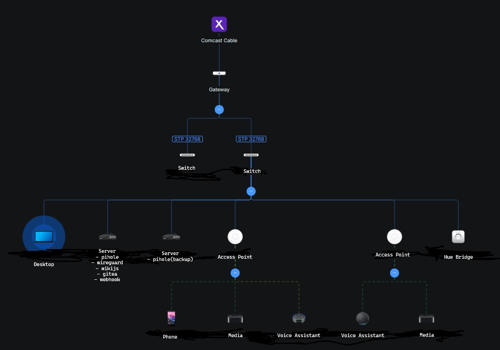

# homelab-ops
Documentation for home network, lab, and projects.

# Work In Progress

This repo is in progress - please pardon the rough formatting and editing in places.

## Network Infrastructure

### Inventory

| Device Role | Model | Name | IP Address | MAC Address |
| :--- | :--- | :--- | :--- | :--- |
| **Modem** | Netgear CM3000 | - | `192.168.100.1` | `XX:XX:XX:XX:XX:68` |
| **Router** | UniFi UCG Ultra | `Gateway` | `192.168.X.1` | `XX:XX:XX:XX:XX:bd` |
| **Switch** | USW Ultra 60W | `SW_Primary` | `192.168.X.X` | `XX:XX:XX:XX:XX:6a` |
| **Switch** | USW Ultra 60W | `SW_Secondary` | `192.168.X.X` | `XX:XX:XX:XX:XX:ce` |
| **Access Point** | UniFi 6+ | `BR_AP` | `192.168.X.X` | `XX:XX:XX:XX:XX:87` |
| **Access Point** | UniFi 6+ | `LR_AP` | `192.168.X.X` | `XX:XX:XX:XX:XX:d3` |

### Device Details

#### Modem
- **Model:** Netgear CM3000
- **S/N:** `XXXXXXXXXXXX`
- **HW Version:** 1.01
- **Cable FW Version:** 6.01.04
- **Admin Interface:** `192.168.100.1`

#### Router
- **Model:** UniFi Cloud Gateway Ultra (UCG Ultra)
- **Name:** `Gateway`
- **Device Version:** 5.1.12
- **WAN1 MAC:** `XX:XX:XX:XX:XX:c1`

#### Switch
- **Model:** UniFi Switch Ultra 60W (USW Ultra 60W)
- **Name:** `SW_Primary`
- **Device Version:** 2.1.8
- **Uplink:** Port 7 $\rightarrow$ `Gateway` Port 1

#### Switch
- **Model:** UniFi Switch Ultra 60W (USW Ultra 60W)
- **Name:** `SW_Secondary`
- **Device Version:** 2.1.8
- **Uplink:** Port 7 $\rightarrow$ `Gateway` Port 2

#### Access Point
- **Model:** UniFi U6+
- **Name:** `LR_AP`
- **Location:** Living Room
- **Uplink:** `SW_Primary` Port 2
- **Device Version:** 6.7.41
- **WiFi Networks:** All

#### Access Point
- **Model:** UniFi U6+
- **Name:** `BR_AP`
- **Location:** Bedroom
- **Uplink:** `SW_Primary` Port 3
- **Device Version:** 6.7.41
- **WiFi Networks:** All

### Topology

### 1. Segmentation

| VLAN ID | Name / Zone | Subnet Range | Purpose & Access Control |
| :--- | :--- | :--- | :--- |
| **VLAN 2** | Management (`mgmt`) | `192.xx.xx0/24` | Core infrastructure, hypervisors, switches, and gateway management planes. |
| **VLAN 3** | Trusted (`trusted`) | `192.xx.xx.0/24` | Primary workstations, servers (`netone.internal`), and trusted internal clients. |
| **VLAN 4** | IoT (`iot`) | `192.xx.xx.0/24` | Smart home devices, isolated from trusted compute and management planes. |
| **VLAN 5** | Guest (`guest`) | `192.xx.xx.0/24` | Isolated wireless access for visitors with strict internet-only egress. |

